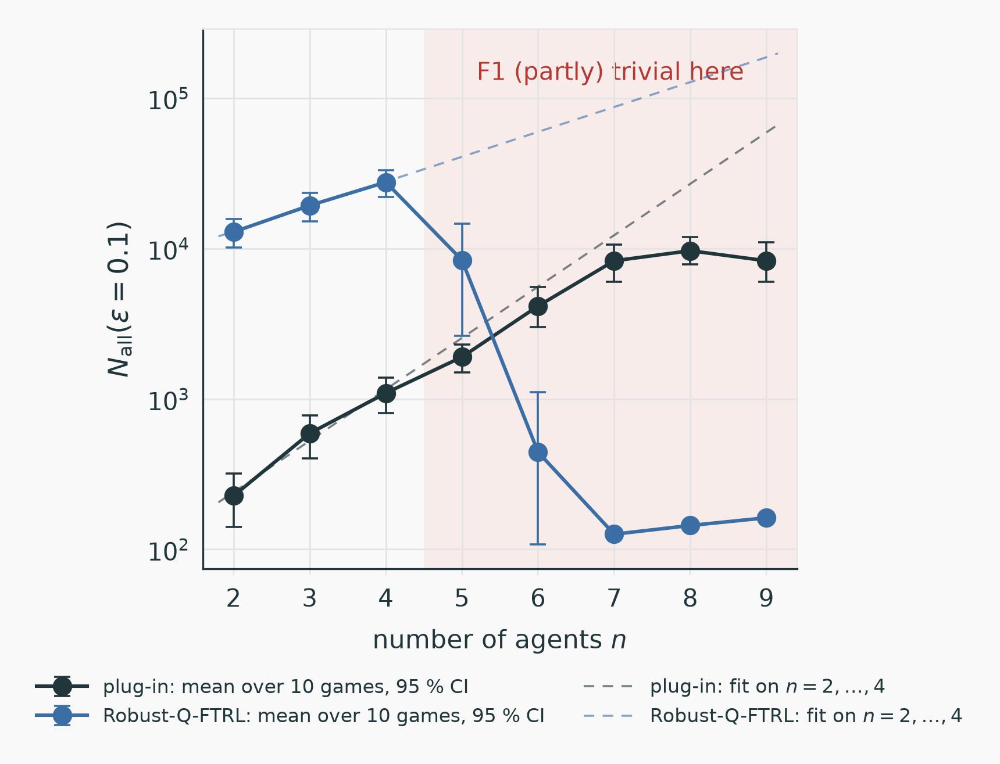
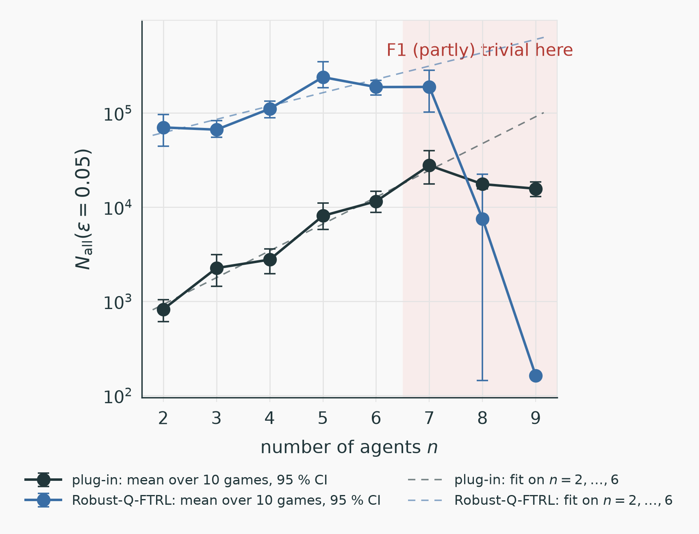
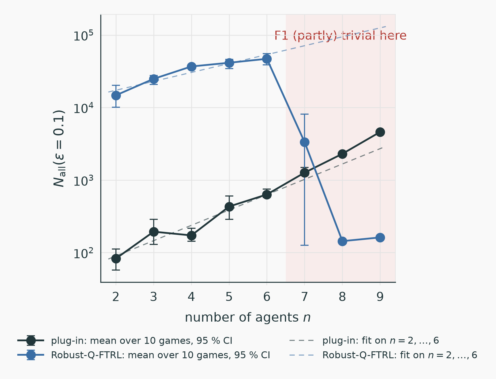
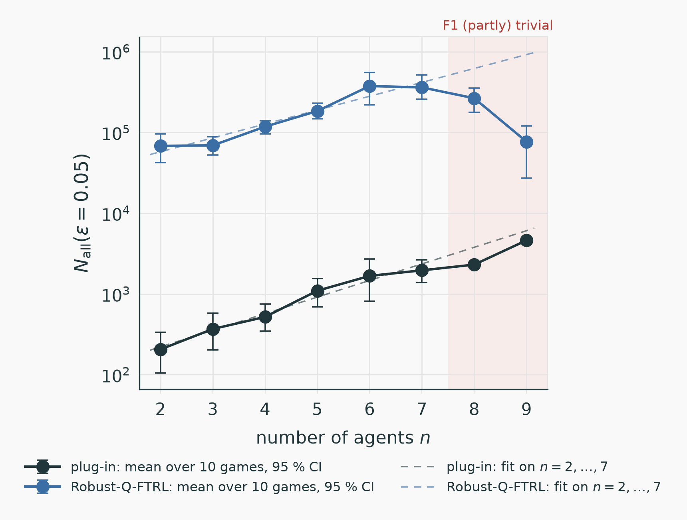

# Experiment C1: sample complexity versus the number of agents

## Question

Theorem 2 says Robust-Q-FTRL finds an ε-robust CCE with a number of samples that grows with
Σᵢ Aᵢ, not ∏ᵢ Aᵢ. We can't check the constants (H⁶, ε⁻⁴), but we can check the **shape in n**:

> When only the number of agents n changes, does the number of samples needed to reach
> gap ≤ ε grow polynomially (Robust-Q-FTRL) or exponentially (a method that queries every
> joint action)?

Two sub-questions from the README: does N = 1 sample per iteration suffice in practice, and
does a larger σ need fewer samples (not run yet)?

## Hypotheses

| Method | Expected N_all(ε) |
|---|---|
| [plug-in baseline](../3_methods/plugin_baseline.md) | ∝ Aⁿ = 2ⁿ |
| [Robust-Q-FTRL](../3_methods/robust_q_ftrl.md) | ∝ n, if the K and N needed don't grow with n |

## Design

**Held fixed:** game family F1 ([game_F1.md](../2_environment/game_F1.md)), S = 3 states,
H = 3 steps, A = 2 actions per agent, σ = 0.3, c_α = 1, c_b = 0, success rate 90 %.

**Two settings of F1** (same code, different generator parameters):

| Setting | β (Dirichlet) | w (state term) | Config | Results |
|---|---|---|---|---|
| **A** | 1.0 | 0.5 | `scaling_n.yaml` with `beta: 1.0`, `w: 0.5` | `results/scaling_n/20261119-202618/` |
| **B** | 0.1 | 0 | `experiments/configs/scaling_n.yaml` | `results/scaling_n/20261119-213140/` |

Setting B has peaked transitions (small β) and pure-noise rewards (w = 0). A single agent
matters more: the gap of the uniform policy is about 1.65× larger than in A for the same n
([F1_triviality.md](../2_environment/F1_triviality.md)), so F1 stays non-trivial up to larger n.

**Varied:** n = 2, 3, …, 9.

**Repetitions:**
- **10 game instances per n:** independent random games, so results aren't tied to one game;
- **10 sampling seeds per instance and budget:** the randomness of the samples.

**Budgets** (doubling grids):
- plug-in: m = 1, 2, 4, …, 128 samples per joint action, solved with K = 2000
- Robust-Q-FTRL: N ∈ {1, 4}, K ∈ {1, 32, 64, …, 2048}. K = 1 outputs the uniform policy and
  marks instances that need no learning ([triviality_check.md](triviality_check.md)).
- exact solver on the true model (K = 2000, no samples): the floor no method can beat.

**Targets:** ε = 0.1 and ε = 0.05.

## Procedure

1. For each n and instance, generate the game.
2. Run every method with every budget and every sampling seed. Count the simulator queries,
   and compute the gap of the output exactly on the true model.
3. Per instance, N_all(ε) = the cheapest budget at which at least 9 of 10 seeds reach
   gap ≤ ε ([metrics.md](../1_introduction/metrics.md)).
4. Across the 10 instances per n: geometric mean.

## Results

### Solver floor

Mean (max) gap of the exact solver on the true model, 10 instances per n:

| n | 2 | 3 | 4 | 5 | 6 | 7 | 8 | 9 |
|---|---|---|---|---|---|---|---|---|
| A | 0.022 (0.028) | 0.024 (0.031) | 0.025 (0.032) | 0.029 (0.032) | 0.030 (0.035) | 0.031 (0.035) | 0.029 (0.034) | 0.025 (0.029) |
| B | 0.018 (0.027) | 0.016 (0.026) | 0.022 (0.026) | 0.024 (0.030) | 0.027 (0.031) | 0.030 (0.036) | 0.032 (0.038) | 0.032 (0.037) |

Both targets are reachable for every n in both settings.

### Where F1 is trivial

Instances (of 10) already solved by the uniform policy (Robust-Q-FTRL with K = 1):

| n | 2 | 3 | 4 | 5 | 6 | 7 | 8 | 9 |
|---|---|---|---|---|---|---|---|---|
| A, ε = 0.1 | 0 | 0 | 0 | 3 | 9 | 10 | 10 | 10 |
| A, ε = 0.05 | 0 | 0 | 0 | 0 | 0 | 1 | 9 | 10 |
| B, ε = 0.1 | 0 | 0 | 0 | 0 | 0 | 8 | 10 | 10 |
| B, ε = 0.05 | 0 | 0 | 0 | 0 | 0 | 0 | 1 | 4 |

**Informative range** (no instance solved at K = 1): A: n = 2–4 (ε = 0.1), n = 2–6
(ε = 0.05). B: n = 2–6 (ε = 0.1), n = 2–7 (ε = 0.05).

### N_all(ε), setting A

| n | plug-in, ε = 0.1 | Robust-Q-FTRL, ε = 0.1 | plug-in, ε = 0.05 | Robust-Q-FTRL, ε = 0.05 |
|---|---|---|---|---|
| 2 | 177 (m = 8) | 12,161 (K = 256) | 709 (m = 32) | 59,886 (K = 1024) |
| 3 | 501 (m = 8) | 18,241 (K = 256) | 1,871 (m = 32) | 63,518 (K = 1024) |
| 4 | 1,003 (m = 8) | 26,067 (K = 256) | 2,469 (m = 16) | 104,267 (K = 1024) |
| 5 | *1,746 (m = 8)* | *2,036 (3 of 10 at K = 1)* | 6,984 (m = 32) | 211,728 (K = 2048) |
| 6 | *3,743 (m = 8)* | *153 (9 of 10 at K = 1)* | 10,586 (m = 16) | 179,657 (K = 2048) |
| 7 | *7,486 (m = 8)* | *126 (all at K = 1)* | *22,692 (m = 16)* | *74,105 (1 of 10 at K = 1)* |
| 8 | *9,216 (m = 4)* | *144 (all at K = 1)* | *17,198 (m = 8)* | *269 (9 of 10 at K = 1)* |
| 9 | *7,486 (m = 2)* | *162 (all at K = 1)* | *14,971 (m = 4)* | *162 (all at K = 1)* |

For n = 2–8 these are identical to the earlier sweeps of 8, 14 and 19 Nov.

### N_all(ε), setting B

Geometric mean over 10 instances, typical (median) budget in brackets. All instances were
solved by both methods at both ε. Rows in *italics* are in the trivial range.

| n | plug-in, ε = 0.1 | Robust-Q-FTRL, ε = 0.1 | plug-in, ε = 0.05 | Robust-Q-FTRL, ε = 0.05 |
|---|---|---|---|---|
| 2 | 72 (m = 4) | 13,033 (K = 256) | 144 (m = 8) | 55,875 (K = 1024–2048) |
| 3 | 165 (m = 2) | 24,069 (K = 512) | 269 (m = 4) | 63,518 (K = 1024) |
| 4 | 165 (m = 1) | 36,864 (K = 512) | 437 (m = 2) | 111,751 (K = 2048) |
| 5 | 380 (m = 2) | 40,115 (K = 512) | 873 (m = 4) | 171,977 (K = 2048) |
| 6 | 617 (m = 1) | 44,914 (K = 512) | 1,152 (m = 2) | 312,801 (K = 2048) |
| 7 | *1,235 (m = 1)* | *333 (8 of 10 at K = 1)* | 1,746 (m = 2) | 317,694 (K = 2048) |
| 8 | *2,304 (m = 1)* | *144 (all at K = 1)* | *2,304 (m = 1)* | *128,368 (1 of 10 at K = 1)* |
| 9 | *4,608 (m = 1)* | *162 (all at K = 1)* | *4,608 (m = 1)* | *7,857 (4 of 10 at K = 1)* |

All Robust-Q-FTRL budgets at the median have N = 1 except n = 2, ε = 0.05.

### N_all(ε), setting A

| n | plug-in, ε = 0.1 | Robust-Q-FTRL, ε = 0.1 | plug-in, ε = 0.05 | Robust-Q-FTRL, ε = 0.05 |
|---|---|---|---|---|
| 2 | 177 (m = 8) | 12,161 (K = 256) | 709 (m = 32) | 59,886 (K = 1024) |
| 3 | 501 (m = 8) | 18,241 (K = 256) | 1,871 (m = 32) | 63,518 (K = 1024) |
| 4 | 1,003 (m = 8) | 26,067 (K = 256) | 2,469 (m = 16) | 104,267 (K = 1024) |
| 5 | *1,746 (m = 8)* | *2,036 (3 of 10 at K = 1)* | 6,984 (m = 32) | 211,728 (K = 2048) |
| 6 | *3,743 (m = 8)* | *153 (9 of 10 at K = 1)* | 10,586 (m = 16) | 179,657 (K = 2048) |
| 7 | *7,486 (m = 8)* | *126 (all at K = 1)* | *22,692 (m = 16)* | *74,105 (1 of 10 at K = 1)* |
| 8 | *9,216 (m = 4)* | *144 (all at K = 1)* | *17,198 (m = 8)* | *269 (9 of 10 at K = 1)* |
| 9 | *7,486 (m = 2)* | *162 (all at K = 1)* | *14,971 (m = 4)* | *162 (all at K = 1)* |

For n = 2–8 these are identical to the earlier sweeps of 8, 14 and 19 Nov.

### Plots

N_all(ε) against n on a log scale. Points are the arithmetic mean over the 10 instances, with
a 95 % bootstrap interval (instances resampled). They are somewhat higher than the geometric
means in the tables, most visibly where a few instances need a much larger budget. The dashed
lines are semi-log fits on the informative range. The shaded region starts at the first n where
any instance is already solved at K = 1, the rows in *italics* in the tables.

| | ε = 0.1 | ε = 0.05 |
|---|---|---|
| **Setting A** (β = 1, w = 0.5) |  |  |
| **Setting B** (β = 0.1, w = 0) |  |  |

In every panel plug-in (dark) rises as a straight line on the log scale, while Robust-Q-FTRL
(blue) rises more slowly and stays above it in the informative range. In the shaded region
Robust-Q-FTRL drops to the cost of the uniform policy, which is not learning.

### Growth rates

The cost of each method splits into a fixed structural part and a per-agent budget:

```
plug-in        N_all = 9 · 2ⁿ · m       structural part 2ⁿ: exponential, ×2 per agent
Robust-Q-FTRL  N_all = 18 · n · K · N   structural part n: linear, log-log exponent 1
```

If the budget needed (m, or K·N) stays constant in n, plug-in grows exactly ×2 per agent and
Robust-Q-FTRL exactly linearly. Any deviation comes from the budget drifting with n.

**Fits.** Least squares on the geometric means of N_all over the 10 instances, informative range
only (no instance solved at K = 1). Each method is fitted both ways:

- *factor per agent*: semi-log fit log₂ N_all = a + b·n, reported as 2ᵇ (2.0 = pure exponential);
- *log-log exponent*: log N_all = a + c·log n (1.0 = linear in n).

| Setting | ε | Range | Plug-in: factor per agent | Plug-in: log-log exponent | Robust-Q-FTRL: factor per agent | Robust-Q-FTRL: log-log exponent |
|---|---|---|---|---|---|---|
| A | 0.1 | n = 2–4 | **×2.38** | 2.51 | ×1.46 | **1.09** |
| A | 0.05 | n = 2–6 | **×1.96** | 2.44 | ×1.41 | **1.22** |
| B | 0.1 | n = 2–6 | **×1.67** | 1.85 | ×1.35 | **1.14** |
| B | 0.05 | n = 2–7 | **×1.65** | 2.01 | ×1.49 | **1.57** |

Bold is the model each method is expected to follow. The two model types can't be fully
separated on 3–6 points, so read the columns together. Plug-in's log-log exponents (1.85–2.51)
are far above 1, and Robust-Q-FTRL's factors per agent (×1.35–1.49) are far below 2.

**Total growth over the informative range**, compared with a constant budget:

| Setting | ε | Range | Plug-in | Pure ×2 per agent | Robust-Q-FTRL | Pure linear (n_max / 2) |
|---|---|---|---|---|---|---|
| A | 0.1 | n = 2–4 | ×5.7 | ×4 | ×2.1 | ×2 |
| A | 0.05 | n = 2–6 | ×14.9 | ×16 | ×3.0 | ×3 |
| B | 0.1 | n = 2–6 | ×8.6 | ×16 | ×3.4 | ×3 |
| B | 0.05 | n = 2–7 | ×12.1 | ×32 | ×5.7 | ×3.5 |

**Budget drift** (median budget per instance across the informative range):

| Setting | ε | Plug-in m | Robust-Q-FTRL K (N = 1) |
|---|---|---|---|
| A | 0.1 | 8 for every n | 256 for every n |
| A | 0.05 | 32 → 16 (alternating) | 1024 (n = 2–4) → 2048 (n = 5–6) |
| B | 0.1 | 4 → 1 | 256 (n = 2) → 512 (n = 3–6) |
| B | 0.05 | 8 → 2 | 1024 (n = 2–3) → 2048 (n = 4–7) |

**Reading, per case:**

- **A, ε = 0.1:** the textbook case. Both budgets are constant, so plug-in doubles per agent
  (×2.38, slightly above 2 from instance spread) and Robust-Q-FTRL is linear (exponent 1.09).
- **A, ε = 0.05:** plug-in is again ≈ ×2 per agent (×1.96). Robust-Q-FTRL is close to linear
  (1.22); K doubles once (at n = 5), which adds the extra growth.
- **B, ε = 0.1:** plug-in's m falls from 4 to 1 as n grows (peaked transitions make one sample
  per joint action enough), so its fitted factor drops to ×1.67. It cannot go lower: at m = 1
  it is the floor 9·2ⁿ and doubles exactly from there (median n = 6 → 9: 576 → 4,608, ×2 per agent).
  Robust-Q-FTRL is linear (1.14) with K = 512 from n = 3 on.
- **B, ε = 0.05:** the least clean case for both. Plug-in's m falls from 8 to 2 (×1.65 per agent).
  Robust-Q-FTRL's exponent 1.57 comes from the single step K = 1024 → 2048 between n = 3 and 4,
  and from a few instances needing N = 4 at n = 6. With K = 2048 fixed (n = 4–7) its N_all
  grows ×2.8 for ×1.75 more agents.

**Conclusion.** In all four cases Robust-Q-FTRL's growth is close to linear in n (exponent
1.1–1.6) with a per-agent budget that changes at most by one doubling of K. Plug-in grows by
×1.65–2.4 per agent. Where its m is constant (setting A) that is the full ×2 of the 2ⁿ term.
Where m falls (setting B) the fitted rate is lower, but the cost is bounded below by 9·2ⁿ.
Robust-Q-FTRL's absolute cost is still higher in every informative case (see the N_all tables).

### What the numbers show

- **Plug-in grows exponentially.** In A it needs m ≈ 8 per joint action for every n, so its
  cost doubles per agent. In B the transitions are nearly deterministic: from n ≈ 6 a single
  sample per joint action (m = 1) suffices, and the plug-in cost is the floor 9·2ⁿ of any
  joint-action method. The fitted factor per agent is below 2 in B because m* falls from 4 to
  1 over the informative range; once m = 1, the cost doubles exactly.
- **Robust-Q-FTRL's per-agent budget doesn't grow with n.** In B at ε = 0.1 it needs K = 512
  (N = 1) for every n from 3 to 6, so N_all = 18·512·n grows linearly (log-log exponent 1.14).
  At ε = 0.05 it needs K = 2048 from n = 4 to 7 (and at n = 8 for 9 of 10 instances); the
  higher exponent (1.57) comes from the step K = 1024 → 2048 between n = 3 and 4.
- **Robust-Q-FTRL is far more expensive in absolute terms.** In the informative range it needs
  73–223× more samples than plug-in in B at ε = 0.1 (182–388× at ε = 0.05) and 26–69× in A
  at ε = 0.1. Plug-in gets its 2000
  solver iterations free on the estimated model, while Robust-Q-FTRL pays for every
  iteration. The gap is larger in B because plug-in gets away with m = 1 there.

## Interpretation

**The shape of the claim holds; the absolute advantage can't be shown on F1 for n ≤ 9.**

- Consistent with Theorem 2: the per-agent budget (K, N) is independent of n, and the cost has
  no 2ⁿ term. Setting B confirms this over five values of n (2–6) instead of three.
- Above the informative range F1 is trivial: the uniform policy already has gap ≤ ε, and
  Robust-Q-FTRL's N_all collapses to 18·n (the K = 1 cost).

## Duration

8 parallel processes run times on MacBook Pro.

| Sweep | Runs | Wall time | Compute time |
|---|---|---|---|
| Setting A, all methods | 19,280 | 32 min | 4.2 h |
| Setting B, all methods | 19,280 | 31 min | 4.1 h |
